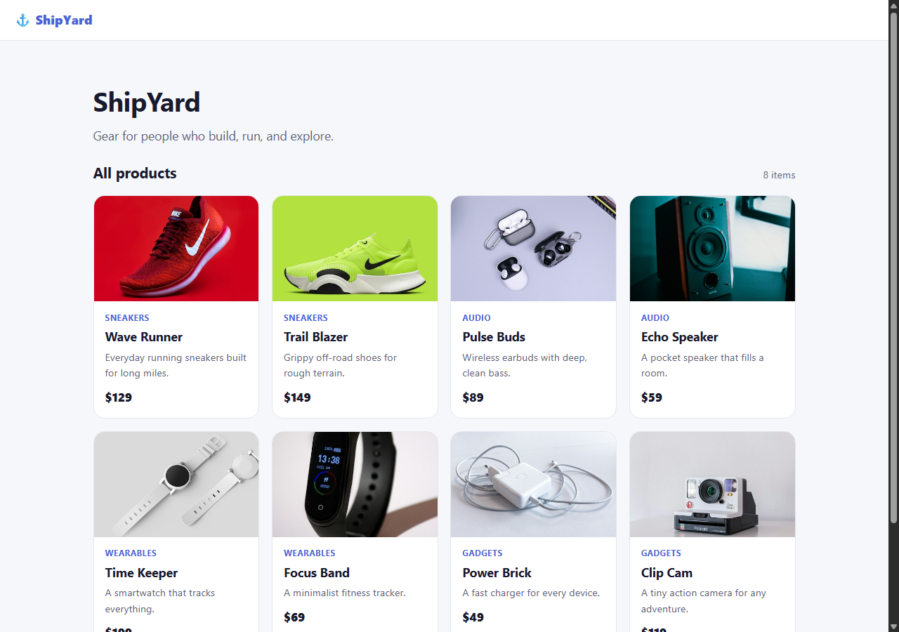
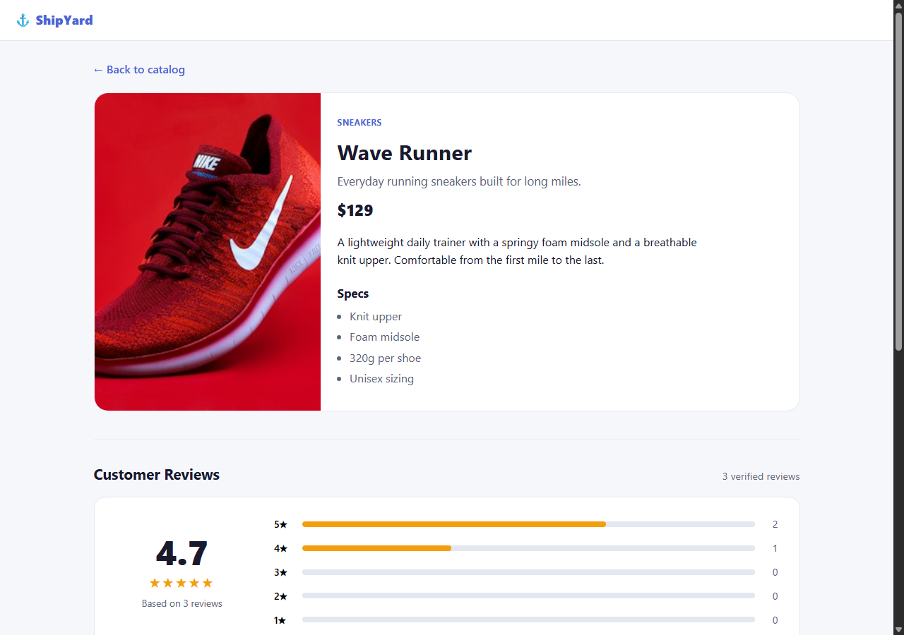
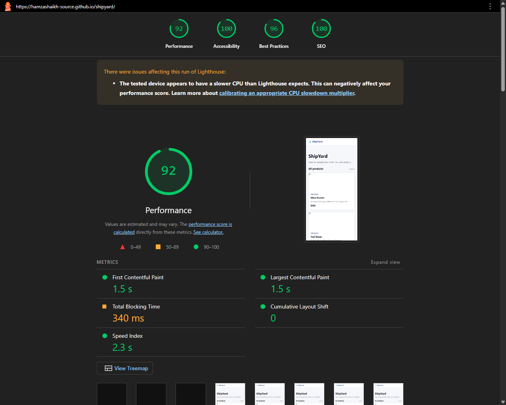

# ShipYard

A modern, fast product-catalog storefront built with Next.js + TypeScript, fully optimized and deployed to GitHub Pages.

- **Live Storefront**: https://hamzashaikh-source.github.io/shipyard/
- **Live Detail Page**: https://hamzashaikh-source.github.io/shipyard/products/wave-runner/
- **Lighthouse Performance**: 92 (Mobile)

---

## Live Previews

### Catalog Storefront


### Product Detail Page


### Lighthouse Audit (Mobile)


---

## Run Locally

```bash
npm install
npm run dev
```

Open [http://localhost:3000](http://localhost:3000) to view the catalog.

---

## What It Does & Performance Highlights

- **`next/image` with Explicit Dimensions & `priority`**: Zero layout shift (CLS = 0) across all product cards and product detail views. The first above-the-fold catalog image and the main detail hero image both use `priority` (`fetchPriority="high"`) for optimal Largest Contentful Paint (LCP).
- **`next/font` with Inter**: Preloaded Latin subset with `display: "swap"`, preventing FOIT/FOUT without runtime Google Fonts requests.
- **`next/dynamic` Lazy Loading**: Customer reviews below the fold are split into an on-demand chunk with a fallback placeholder.
- **Resilient States**: Friendly `app/loading.tsx` indicator, Client Component `app/error.tsx` error boundary with retry (`reset()`), and `app/not-found.tsx` 404 screen.
- **Static Export**: Built with `output: "export"` and deployed automatically to GitHub Pages via GitHub Actions.
